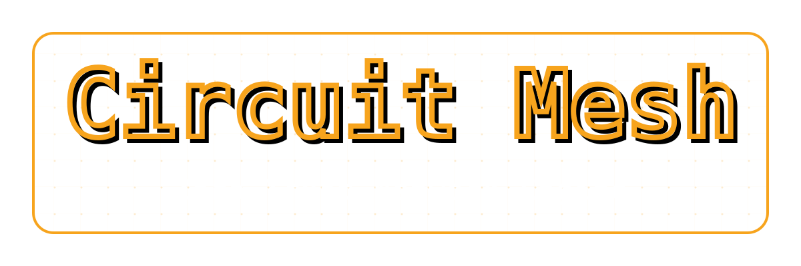

<!--
SPDX-FileCopyrightText: 2026 TSUKUMO Akito <tsukumoakito99@duck.com>
SPDX-License-Identifier: AGPL-3.0-or-later OR LicenseRef-circuit-mesh-Commercial
-->

<p align="center">
  
</p>

# Circuit Mesh (Zero-Trust Network Engine)

[日本語版のREADMEはこちら (Japanese version available here)](./README_ja.md)

[](https://ziglang.org)
[](LICENSE)

**A Zero-Trust Network Engine for Secure DNS Egress and Identity Rotation.**

`Circuit Mesh` is a high-performance network barrier and proxy manager written in Zig. It leverages Linux Netlink (IPSet) to dynamically control network access, forcing traffic through isolated Tor circuits with automated identity rotation and DoH/DoT fallback mechanisms.

The core command, `circuit-mesh`, operates as a gatekeeper, ensuring that your system's network egress remains within a strictly defined perimeter of trusted nodes.

---

## Key Features

- **Dynamic Network Barrier**: Direct manipulation of Linux IPSet via Netlink to maintain a "Zero-Trust" perimeter. Only authenticated Tor nodes and designated DNS upstreams are permitted.
- **Hybrid DNS Tunneling**:
    - **DoT (DNS over TLS)**: Native Zig TLS implementation for high-efficiency tunneling over Tor.
    - **DoH (DNS over HTTPS)**: Integrated OpenSSL/H2 (HTTP/2) engine for robust fallback when native TLS is restricted.
- **Tor Identity Mastery**:
    - Automatic extraction of Directory Authorities (DA) and Guard nodes from Tor binaries and state files.
    - Per-tunnel SOCKS5 authentication rotation with seamless circuit purging via Tor ControlPort.
- **Success-Driven Rotation**: Logic-based identity switching triggered by TTL expiration or consecutive connection failures.
- **Memory Efficient**: Built with Zig’s manual memory management and custom tracking allocators for predictable resource usage in hardened environments.

---

## 🛡️ Is Clearing Your Browser History Enough? The Overlooked Blind Spot of "DNS"

When surfing the web, many people take precautions such as using "Incognito mode" (private browsing) or regularly clearing their browser history. Of course, these are vital steps to ensure no traces are left directly on your device.

However, **no matter how cleanly you erase your browser history, it means nothing if your communication's "destination" is completely exposed to the outside world.** The key vulnerability here is **"DNS"**.

### What is "DNS" Anyway?

DNS (Domain Name System) is, so to speak, the **"giant phonebook of the internet"**.
When we type `example.com` into our browsers, our computers or smartphones cannot connect to that site directly. They need to query an internet phonebook, asking, *"Where is the actual IP address for this domain (e.g., 93.184.216.34)?"* This querying mechanism is what we call DNS.

### By Default, All Your Activity is Fully Exposed to Your ISP

On a default, out-of-the-box configuration of a PC or smartphone, queries to this phonebook (DNS queries) are sent **in plain text ("like an open postcard") to the servers of your contracted Internet Service Provider (ISP, mobile carrier, fiber-optic provider, etc.)**.

This means:

- What medical symptoms you searched for in the middle of the night.
- Which news sites or social media platforms you visit and how often.
- What services you attempted to log into.

Every single one of these "destinations at the exact moment of access" (domain names) is **recorded (logged) in real-time by your ISP and any intermediary Wi-Fi administrators.** No matter how thoroughly you clear your browser history, your complete activity record remains sitting on your provider's servers.

---

## ⚙️ How Does Circuit Mesh Specifically Prevent DNS Leaks?

That is why, alongside browser-level precautions, you need a system that **completely hides DNS queries themselves and prevents anyone from tracking them.**

However, an important reality to note is that **simply installing `Circuit Mesh` on your computer will not magically alter your system settings overnight.**
To truly protect your DNS privacy, you need a well-constructed "routing pipeline" across your entire system. Specifically, true privacy only functions when you build and integrate your environment as follows:

1. **Deploying a Local Forwarder (e.g., AdGuard Home or Pi-hole)**
   - Run a local DNS filter such as `AdGuard Home` or `Pi-hole` on your host to intercept all DNS requests originating from your devices.
2. **Forcibly Blocking Port 53 (Plaintext DNS)**
   - Use your computer/router settings or the `Circuit Mesh` Netlink barrier to completely ban and block unencrypted standard DNS traffic (port 53). This prevents accidental plaintext leaks to the outside world.
3. **Proper Routing of VPN and OS DNS Settings**
   - Even when using a commercial VPN (such as NordVPN), instead of blindly relying on the VPN provider's proprietary DNS servers, all queries must be placed under local management.
4. **Backend Processing via "Tor + Load-Balancing" by Circuit Mesh**
   - `Circuit Mesh` takes over the correctly routed, locally aggregated DNS queries.
   - `Circuit Mesh` **randomly distributes (load-balances) these queries across 10 upstream DNS providers**, sending each one outward via **completely independent, isolated Tor circuits** using DoT (DNS over TLS).

### Conclusion

Protecting your browser history while preventing DNS leaks through Circuit Mesh and proper local configuration—only when these two elements come together is a true privacy defense grid completed for the modern internet.

`Circuit Mesh` serves as the engine that executes the most complex and heavy part of this defense grid—**"the Tor-driven encryption, distribution, and fail-safe backend"**—with extreme robustness powered by Zig.

---

## System Architecture

1. **Discovery Phase**: Scans Tor binary and consensus files to populate the initial "Safe IP" list.
2. **Netlink Barrier**: Synchronizes the kernel IPSet with the discovered IPs, effectively locking the network.
3. **DNS Service**: Listens on local UDP/TCP ports, wrapping queries into encrypted DoT/DoH tunnels.
4. **Watchdog**: Monitors tunnel health and rotates SOCKS credentials to ensure egress IP diversity.

---

## Technical Prerequisites

- **Zig Compiler**: `0.15.2` (Strictly enforced. Migration to 0.16.0 is planned).
- **Linux Kernel**: Must support `IPSet` and `Netlink`.
- **Dependencies**:
    - `OpenSSL`: Required for HTTP/2 (DoH) support.
    - `scdoc`: Required for generating man pages.
    - `Tor`: Must be running with `ControlPort` and `CookieAuthentication` enabled.

---

## Installation

### Arch Linux (via AUR)

Arch Linux users can install `circuit-mesh` from the AUR (Arch User Repository). This is the recommended method as it handles dependencies and systemd integration automatically according to Arch standards.

| Package | Version | Description | Votes | Links |
| :--- | :--- | :--- | :--- | :--- |
| **circuit-mesh** |  | Zero-Trust Network Engine |  | [](https://aur.archlinux.org/packages/circuit-mesh) [](./LICENSE) |

```bash
# Example using an AUR helper
yay -S circuit-mesh

# Using paru
paru -S circuit-mesh
```

### Other Linux Distributions (from Source)

For other distributions, you can build and install manually using the provided Makefile.

```bash
# Clone the repository
git clone https://codeberg.org/tsukumoakito/circuit-mesh.git
cd circuit-mesh

# 1. Build the binary
make build

# 2. Install to system (/usr/bin, /etc, etc.)
sudo make install

# 3. Uninstall from system
sudo make uninstall
```

---

## Execution

The `circuit-mesh` command requires root privileges (or `CAP_NET_ADMIN`) to manipulate the Netlink barrier.

```bash
# Run with high-density telemetry on Barrier sync and Tunnel health
sudo circuit-mesh --debug

# Run with a specific configuration path
sudo circuit-mesh --config /path/to/config.json
```

---

## Implementation Status & Roadmap

| Feature | Status | Description |
| :--- | :--- | :--- |
| **Netlink Engine** | ✅ Stable | IPSet manipulation for IPv4/IPv6. |
| **Tor Discovery** | ✅ Stable | Extraction from Binary/State/Consensus. |
| **DNS Tunnels** | ✅ Stable | DoT (Native) and DoH (OpenSSL/H2). |
| **Identity Rotation** | ✅ Stable | Credential rotation and Circuit Purging. |
| **Native DNS Load Balancer** | 🛠️ Planned | Optional multi-upstream load-balancing without external forwarders. |
| **Zig 0.16.0** | 🛠️ Planned | Migration to the latest compiler. |
| **Email Proxy** | 🛠️ Planned | IMAP/SMTP isolated proxying. |
| **Generic Proxies** | 🛠️ Planned | Support for I2P/VPN group chains. |

---

## Documentation

- **Man Pages**: Unix/Linux/macOS users can refer to `man circuit-mesh` for terminal-native documentation.
- **Local Manual (Build Output)**: After running `zig build`, copies of the manual are available in `zig-out/doc/`. This is recommended for environments without `man` (e.g., native Windows).
- **Full Manual (Repository Source)**: For web-friendly reading or deep dive:
  - [User Manual (English)](./doc/MANUAL.md)
  - [User Manual (Japanese)](./doc/MANUAL_ja.md)

---

## License

Dual-licensed under:

- **GNU Affero General Public License v3.0 or later (AGPL-3.0-or-later)**
- **Commercial License** (See [COMMERCIAL](./doc/COMMERCIAL.md) for details)

---
**Developer Note**: This project is currently in an experimental beta state. Use with caution in production environments requiring high availability.
